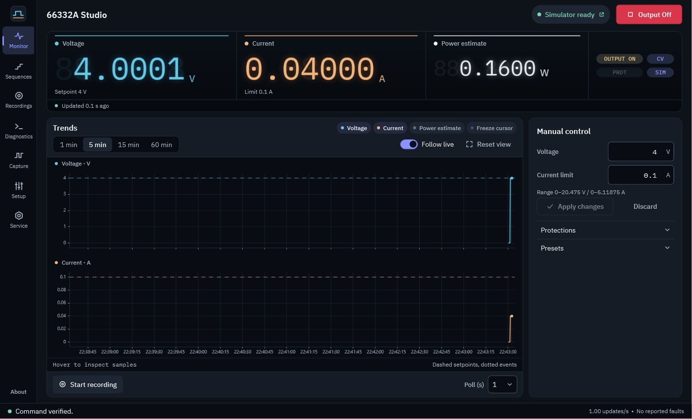
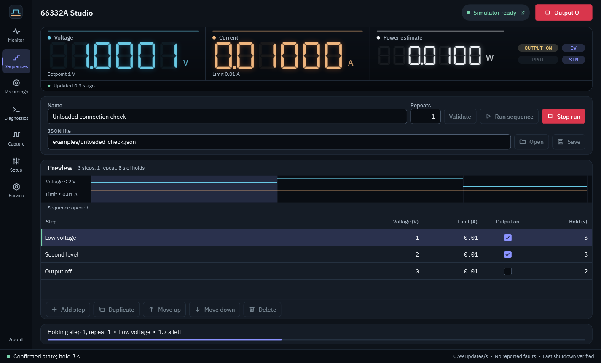
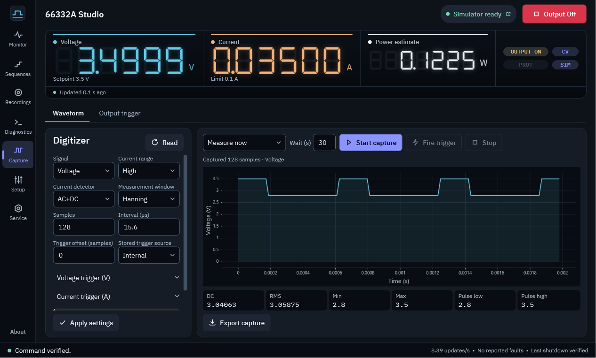
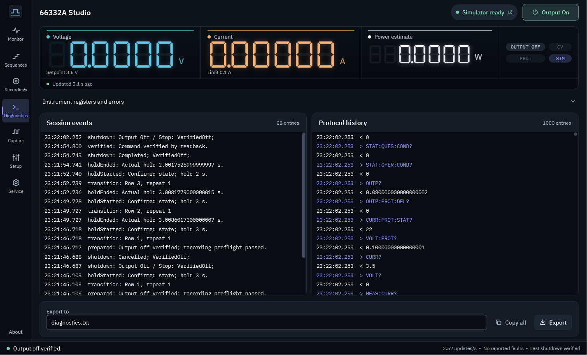

# 66332A Studio

66332A Studio is a Windows desktop app for the HP/Agilent 66332A Dynamic Measurement DC Source. It connects to one instrument over RS-232 for live measurements, output control, waveform capture, and recorded test sequences. A built-in simulator lets you try the same workflows without a supply.

**RS-232 preview · Windows 11 x64.** Basic control and selected capture and trigger workflows have been exercised on one unloaded 66332A. Wider hardware compatibility and clean-PC installation remain unverified. Start with the simulator. See the [test evidence](docs/implementation-status.md) and [hardware qualification guide](docs/command-audit.md).



## Quick start

### Run the packaged app

If you have the Windows x64 preview package, extract the whole archive and open `Agilent66332A.Desktop.exe`. The package includes the .NET runtime. Keep the executable with its companion files.

To start in simulator mode, run this from the extracted folder in PowerShell:

```powershell
.\Agilent66332A.Desktop.exe --simulator
```

### Run from source

From the repository root on Windows, use PowerShell:

```powershell
# Only if you don't already have the SDK specified in global.json:
.\tools\bootstrap.ps1

.\tools\dev.ps1 -Simulator
```

In either build, wait for **Simulator ready**, then open **Sequences**. Paste the full path to [`examples/unloaded-check.json`](examples/unloaded-check.json), click **Open**, then choose **Run sequence**. Watch the setpoints change and find the completed run in **Recordings**.

## Features

The screenshots show the app connected to its built-in simulator.

### Monitor and manual control

View live voltage, current, and estimated power alongside the supply's acknowledged setpoints. Choose a trend window from 1 to 60 minutes, follow the latest readings, or freeze the cursor to inspect a sample. Dashed traces show setpoints and dotted markers show session events.

Stage a voltage setpoint and current limit for review, then apply them and check the readback. Save named presets for reuse, adjust overvoltage and overcurrent protection, and start or stop a manual recording from the same workspace.

### Sequences

Build a finite test from steps that specify voltage, current limit, output state, and hold time. Set the repeat count, validate the sequence, and preview the requested levels before running it. During the run, the active row and hold progress show where you are. Sequences can be reopened from JSON, and each run records automatically.



### Waveform capture and output triggers

Configure the digitizer's sample count, interval, and trigger offset. Capture voltage or current immediately, arm on a signal edge, or fire a software trigger. Review the waveform alongside DC, RMS, minimum, maximum, and pulse levels. **Export capture** saves the samples as CSV with the capture settings. The separate **Output trigger** tab stages a voltage and current limit for the instrument to apply when triggered.



### Recordings and diagnostics

Browse manual recordings and sequence runs by start time, source, run outcome, and shutdown result. Open a session folder to find the measurement CSV, event log, and run metadata. Sequence runs also save a copy of the sequence that ran.

Use **Diagnostics** to inspect session events and the SCPI command and response history. Read instrument status registers, drain the error queue, or export the diagnostic log for troubleshooting.



### Setup and service

Use **Setup** to inspect the rear digital port, inhibit and fault settings, front-panel display, and optional relay. **Service** covers instrument memory slots, startup behavior, self-test, reset, and guided calibration. Advanced writes on a physical supply depend on bench qualification.

## Connect a bench supply

Start the app normally (run `.\tools\dev.ps1` from source) and open **Connection**. With the load isolated and the supply output off, select the Windows COM port and match the instrument's front-panel serial settings. The app defaults to 9600 baud, 8N1, no flow control, with DTR and RTS asserted. Use the null-modem wiring appropriate for your serial mode.

On an eligible SCPI connection, the app checks serial Break recovery and verifies output off. **Hardware control ready** means basic control is available for that connection. Advanced writes require bench evidence that matches the instrument and serial setup. Other models and GPIB are outside this preview. [Legacy Compatibility mode](docs/compatibility.md) has more limited control.

**Output Off** (also **Ctrl+Shift+O**) requests shutdown. If the app cannot verify shutdown, check the supply directly. Output readback confirms the supply's output-enable state; it cannot confirm that the load has discharged.

See the [operating guide](docs/operating-guide.md) for bench steps, capture, and recording locations.

## Build and verify

The app uses C#/.NET 10, WPF, CommunityToolkit.Mvvm, and ScottPlot. The instrument, application, and storage libraries are independent of WPF. The SDK and NuGet dependency versions are pinned.

```powershell
. .\tools\environment.ps1
& $script:Dotnet restore Agilent66332A.sln --locked-mode
.\tools\test.ps1       # Automated tests
.\tools\verify-ui.ps1  # Desktop simulator checks
.\tools\publish.ps1    # Build the Windows x64 preview folder
```

Publishing writes to `artifacts/66332A Studio Preview`, with dependency notices, the example sequence, build metadata, and SHA-256 checksums. Both source builds and the package bundle the same DSEG7 Classic font for the seven-segment readouts.

For more detail, see the [implementation and test evidence](docs/implementation-status.md), [RS-232 command coverage](docs/command-audit.md), and [development plans](plans/README.md).

## License

66332A Studio is licensed under the [Apache License 2.0](LICENSE). See [NOTICE](NOTICE) for project attribution and [third-party notices](THIRD-PARTY-NOTICES.md) for the licenses of dependencies and bundled fonts.
