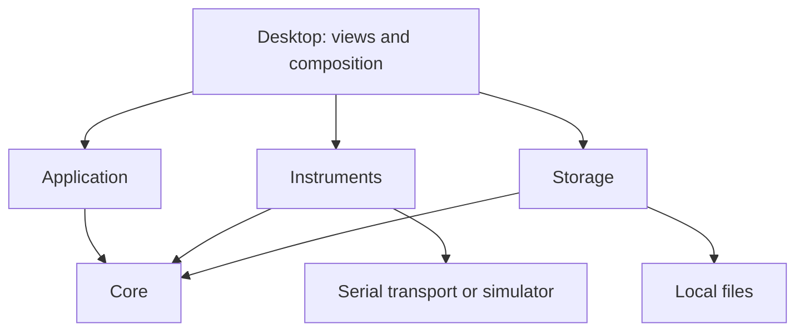

# Technology and architecture

## Decision: C# / .NET 10 / WPF

Use a self-contained Windows x64 desktop application, with WPF for presentation and C# libraries for instrument and application behavior. .NET 10 is an LTS release with support listed through November 14, 2028. Pin a supported SDK and package versions at implementation kickoff; do not use floating versions or copy a patch number from this planning document. [Microsoft support policy](https://dotnet.microsoft.com/en-us/platform/support/policy/dotnet-core)

WPF has the styling and control-template mechanisms needed for the proposed interface. Its default appearance does not determine the product's appearance. Use custom resource dictionaries and templates, with standard control semantics retained. .NET 10 also develops WPF's Fluent styling, but that theme is not the visual specification for this app. [WPF styling](https://learn.microsoft.com/en-us/dotnet/desktop/wpf/controls/styles-templates-overview), [WPF in .NET 10](https://learn.microsoft.com/en-us/dotnet/desktop/wpf/whats-new/net100)

### Alternatives considered

The selection judgments below are project-specific, not claims that the alternatives cannot produce a professional interface.

| Option | Strength for this brief | Tradeoff | Decision |
| --- | --- | --- | --- |
| C# + WPF | Windows integration, editable tables, reusable .NET instrument code, flexible XAML composition. | Requires deliberate styling and a chart-host accessibility check. | Selected for the Windows-only release. |
| C# + Avalonia | Custom XAML UI and a path to multiple operating systems. | Cross-platform packaging/testing adds little value to the current requirement. | Revisit if other operating systems become a requirement. |
| C# + WinUI 3 | Modern Windows UI framework. | Its control and deployment choices would need a separate prototype for this dense table/plot application. | Viable; not enough benefit here to displace WPF. |
| Tauri 2 + TypeScript/React + Rust | Flexible web presentation with a Rust application layer. | Introduces frontend/backend contracts, two application language ecosystems, and a webview boundary around instrument state. | Good alternative if web UI reuse becomes central; not selected now. |
| Python + PySide6 / Qt | Fits the original plan and scientific scripting workflows. | Packaging/runtime management and custom presentation still need investment. Qt Quick could improve presentation, but introduces another UI technology. | Retain as an alternative if Python library reuse becomes a primary constraint. |

Framework descriptions: [Avalonia](https://docs.avaloniaui.net/docs/welcome), [WinUI 3](https://learn.microsoft.com/en-us/windows/apps/winui/winui3/), [Tauri](https://v2.tauri.app/start/), [Qt for Python](https://doc.qt.io/qtforpython-6/).

## Dependency choices

| Area | Planned choice | Boundary |
| --- | --- | --- |
| Presentation | WPF and custom XAML resources | Desktop project only. |
| View models | CommunityToolkit.Mvvm | Observable state and UI commands; no instrument protocol in view models. |
| Trends | ScottPlot.WPF | Small chart adapter/control; replaceable without changing acquisition or storage. |
| Serial | System.IO.Ports | Behind the instrument transport; actual adapter behavior validated in M0/M2. |
| Structured files | System.Text.Json | Versioned sequences, preferences, presets, and run metadata. |
| CSV | A small isolated encoder for the fixed schema, or a pinned maintained library if justified | Correct invariant formatting and escaping are mandatory; do not spread CSV construction across the app. |
| Tests | xUnit with fake clock and scripted transport fixtures | Select stable compatible packages at kickoff. |
| Dependency composition | Explicit composition root; Microsoft.Extensions.DependencyInjection only if it reduces wiring complexity | No service locator or application-wide mutable singleton state. |

The MVVM toolkit is UI-framework independent, and ScottPlot provides a WPF control. The chart integration must preserve this application's gap, threading, and theme requirements; library defaults are not acceptance evidence. [MVVM toolkit](https://learn.microsoft.com/en-us/dotnet/communitytoolkit/mvvm/), [ScottPlot WPF](https://scottplot.net/quickstart/wpf/)

Do not introduce a database, local web server, embedded browser, plugin loader, or message-bus package for the first release. Add dependencies when a specific problem warrants them.

## Proposed repository layout

```text
Agilent66332A.sln
global.json
Directory.Build.props
Directory.Packages.props
src/
  Agilent66332A.Core/
    Models/                 Identity, capabilities, snapshots, samples, outcomes
    Sequences/              Sequence document and pure validation
    Policies/               Bounds, freshness, verification tolerances
    Abstractions/           Instrument, clock, and persistence contracts
  Agilent66332A.Instruments/
    Serial/                 SerialPort transport, framing, deadlines, worker
    Scpi/                   Response parsing and typed command definitions
    Devices/Agilent66332A/   Device profile, command mapping, status decoding
    Simulation/             Deterministic instrument simulator
  Agilent66332A.Application/
    Sessions/               Session coordinator and operation ownership
    Monitoring/             Poll scheduling and snapshot publication
    Control/                Apply, protection, and shutdown coordinators
    Runs/                   Sequence runner and run state
    Recording/              Recording orchestration and failure policy
  Agilent66332A.Storage/
    Sequences/              JSON file handling and migrations
    Preferences/            Settings and preset persistence
    Recordings/             CSV, event stream, metadata, recent-run discovery
    Diagnostics/            Rotating local logs and diagnostic export
  Agilent66332A.Desktop/
    App.xaml                Composition and lifecycle entry point
    Shell/                  Window, navigation, connection, global Output Off
    Features/Monitor/       View and view model
    Features/Sequences/
    Features/Recordings/
    Features/Diagnostics/
    Controls/               NumericUnitEditor, Readout, StatusBadge, TrendPanel
    Themes/                 Colors, typography, spacing, control templates
    Assets/                 Fonts, icons, license notices
tests/
  Agilent66332A.Core.Tests/
  Agilent66332A.Instruments.Tests/
  Agilent66332A.Application.Tests/
  Agilent66332A.Storage.Tests/
  Agilent66332A.Desktop.Tests/
tools/
  dev.ps1
  test.ps1
  publish.ps1
plans/
```

Use namespace/folder separation within these projects before adding more assemblies. Split a class when it gains unrelated responsibilities; do not enforce arbitrary line counts. A shell view model must not become the serial driver, run controller, file writer, and notification manager.

### Dependency direction



Application code calls contracts defined in Core; Desktop wires the implementations. Core has no WPF, serial-port, or filesystem dependency. The Desktop composition root references infrastructure projects, but feature view models interact with application services, not SerialPort.

## Contracts and state

Prefer immutable records for snapshots and events. Separate an operator request from the device's acknowledged state.

| Contract/model | Responsibility |
| --- | --- |
| ConnectionProfile | Port, baud, framing, line endings, line signals, and supported handshake policy. |
| InstrumentIdentity / DeviceCapabilities | Verified model, identification details, supported operations, queried limits, and validated resolution policy. |
| RequestedSettings / AcknowledgedSettings | Distinct desired and read-back values; no shared mutable object pretending to represent both. |
| DeviceSnapshot | Output-enable state, faults, mode, acknowledged settings, session generation, and observation intervals. |
| MeasurementSample / MeasurementPair | Value, unit, start/end timestamps, quality, generation, and optional estimated power. |
| ApplyResult | Requested values, accepted values, per-field verification, and failure reason. |
| ShutdownResult | Reason, request time, verification time if any, and VerifiedOff or Unverified. |
| SequenceDocument / RunSnapshot | Editable versioned input and separate immutable execution/progress state. |
| IInstrumentClient | Typed connect, read, apply, output, protection, local-control, and disconnect operations. |
| IRecordingSession | Append sample/event, observe writer health, finalize; supports injected failures. |
| IMonotonicClock | Elapsed-time source and cancellable wait; production and deterministic test implementations. |

Keep arbitrary SCPI text out of the application-facing API. Use a dedicated `RequestOutputOffAsync(reason)` path so callers cannot accidentally queue it behind an entire run. Operations return outcomes with enough detail to show a truthful UI and write a useful event record.

## Execution model

1. **UI dispatcher:** input, rendering, accessible status, and binding updates only. Never wait synchronously on serial, disk, or task completion.
2. **Session coordinator:** arbitrates manual control, monitoring, sequence ownership, and lifecycle. A run receives an exclusive control lease, not permanent ownership of the serial thread.
3. **Instrument worker:** one worker owns opening, reading, writing, breaking, and closing the port. Its queue serializes protocol exchanges. It checks the shutdown/cancellation latch between bounded I/O slices and before every state-changing command.
4. **Recording worker:** consumes a bounded ordered queue and reports health independently. Storage must not block the path that requests output-off.
5. **UI publication:** immutable snapshots are marshaled onto the dispatcher. Coalesce redundant visual refreshes; never silently drop required recording samples or run events.

The session coordinator does not hold a semaphore across an operation in a way that blocks Output Off from setting the cancellation latch. Every operation carries a session/control generation. Reconnection or shutdown invalidates queued work, and stale completions cannot re-enable UI actions or output.

`SerialPort` supplies the serial abstraction, but cancellation and latency require testing with the chosen adapter. Start with finite synchronous read slices on the dedicated worker, bounded by an overall transaction deadline. An async method name alone is not a guarantee that a pending serial read can be interrupted. [SerialPort](https://learn.microsoft.com/en-us/dotnet/api/system.io.ports.serialport), [ReadTimeout](https://learn.microsoft.com/en-us/dotnet/api/system.io.ports.serialport.readtimeout)

## Simulator and protocol test double

Use two complementary mechanisms:

- A deterministic **instrument simulator** implements IInstrumentClient for the full desktop experience: configured load behavior, quantization, signed current scenarios, CV/CC, faults, latency, and disconnects. Its identity and files always identify it as simulated. It models software workflows, not a certified electrical equivalent.
- A **scripted byte transport** sits below the real SCPI client in tests. It fragments lines, delays or duplicates replies, supplies malformed data, loses the connection, and records command order. This prevents a high-level simulator from hiding real protocol bugs.

Implementation note (November 3, 2026): the preview simulator uses the production typed client/worker over an in-memory byte transport; separate scripted/intercepted byte fixtures exercise protocol failures. This avoids maintaining duplicated command-ordering logic. A developer-only CLI exercises Core, Instruments, Application and Storage without WPF; it is not shipped as a product feature in the portable desktop folder.

## Deployment approach

Publish a self-contained `win-x64` folder and distribute it as a ZIP. Keep trimming and Native AOT disabled initially; favor a predictable WPF/native-chart dependency layout. A self-contained deployment carries its runtime, so the release process must also pick up runtime servicing updates. Test on a machine without a separately installed .NET runtime. [Microsoft publishing guidance](https://learn.microsoft.com/en-us/dotnet/core/deploying/)

Target Windows 11 x64 for initial acceptance. Windows 10 or ARM64 compatibility is an explicit follow-up validation decision, not an inferred promise. The planning task does not establish this PC's OS build or adapter driver compatibility.
