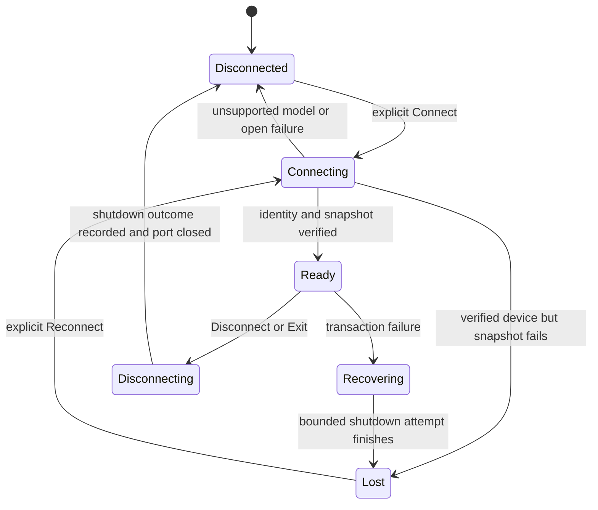

# Instrument control and verified state

## Invariants

These are application requirements inherited from the original brief or refined for the proposed implementation:

1. One worker owns the physical connection. No view model, logger, or sequence row writes around it.
2. Editing, loading a preset, opening a sequence, or connecting never implicitly enables output.
3. A command being sent is not proof of its effect. Show requested and verified state separately.
4. Output Off and run cancellation invalidate pending enabling/setpoint work before any subsequent command is dispatched.
5. Completion, cancellation, failure, intentional disconnect, and orderly exit all use the same shutdown coordinator.
6. A communication failure aborts an active run. Recovery does not replay commands or resume it.
7. Output state becomes unknown when confirmation cannot be trusted. Last-known state is historical, timestamped data.
8. Software cannot guarantee output-off after cable removal, process termination, or loss of power to the PC.

## Manufacturer facts that affect the design

The programming guide supports a selectable NONE flow-control mode; both ends must match. RS-232 Break clears communication buffers without resetting configuration. Fault clearing can restore the prior output state. The protection delay affects CC reporting/OCP, not OVP. Normal remote mode retains the front-panel Local key; remote lockout does not. These details justify the explicit profile, recovery, off-before-clear, delay label, and no-lockout policies below. See printed pages 10-12, 17, 56, and 70 of the [Keysight programming guide](https://www.keysight.com/mt/en/assets/9018-01225/programming-guides/9018-01225.pdf).

## Connection lifecycle

Connection state, output state, protection state, and run state are separate models. Ready means the session is usable, not that the output is off. Disconnected does not mean electrically off. Preserve an unresolved shutdown warning after the port is closed.

Connection procedure:

1. Enumerate ports for display; retain COM7 only as a suggested first profile. Handle missing/busy ports without blocking the UI.
2. Show the complete selected profile. Initially implement the original 9600/4800, 8N1, no-flow-control profile and explicit DTR/RTS settings. Require front-panel RS-232, SCPI, matching baud/parity/framing/flow, and an appropriate cable. Do not silently try other ports, baud rates, languages, or handshake modes.
3. Open the port with finite I/O limits. Query identity before any state-changing command. Parse known HP/Agilent/Keysight manufacturer variants with an exact supported model check; record the raw identity. Reject unsupported models without sending output or configuration commands.
4. Establish normal remote control without front-panel lockout. Read existing setpoints, protections, output command state, mode, faults, and programming limits. Do not reset, clear faults, or load a preset on connect.
5. Publish a snapshot and preserve it as the initial-session baseline for controlled acceptance/restoration workflows. Existing output-on state is displayed prominently; it is not silently toggled just because monitoring begins.
6. If identification succeeded but later initialization fails, attempt the normal output-off shutdown path for that identified device and report its outcome. If identity is unverified, send no arbitrary write in an attempt to make an unknown device safe.

The visible profile must not imply that asserted DTR/RTS substitute for a correctly wired cable or matched flow mode. Additional handshake modes require their own transport behavior and hardware validation before they become selectable.

## Protocol implementation scope

Create typed mappings for identity, voltage/current measurement and setpoint readback, output enable, limits, protection configuration/clear, condition status, error retrieval, and remote/local control. Keep all command strings and register-bit mappings in the device profile. Review each against the manual during M0/M1; test the exact bytes through the scripted transport.

The key command families are `*IDN?`, `MEAS:VOLT?`, `MEAS:CURR?`, `VOLT`, `CURR`, `OUTP`, `VOLT:PROT`, `CURR:PROT:STAT`, `OUTP:PROT:DEL`, `OUTP:PROT:CLE`, `STAT:OPER:COND?`, `STAT:QUES:COND?`, `SYST:ERR?`, `SYST:REM`, and `SYST:LOC`. Limits use the applicable parameter queries with MIN/MAX. Validate support and arguments per command rather than assuming every parameter supports the same query form. [Programming guide, command dictionary](https://www.keysight.com/mt/en/assets/9018-01225/programming-guides/9018-01225.pdf)

Exclude arbitrary console commands, calibration, saved-state recall, trigger programming, and changes to instrument power-on behavior from v1.

## Framing, deadlines, and recovery

- Encode SCPI in ASCII with invariant numeric formatting. Transmit the configured CRLF terminator; parse LF-terminated replies with an optional preceding CR.
- Assemble replies incrementally. A read may contain one byte, a partial line, or multiple terminators. Bound both accumulated bytes and total response time. For scalar/identity/error operations, begin with a 4 KiB line cap; waveform arrays are outside scope.
- Parse scientific notation, signs, surrounding whitespace, and quoted error text deliberately. Reject nonfinite numbers, malformed values, unexpected reply types, and impossible status values.
- Allow one outstanding query. Do not pipeline queries or use undifferentiated semicolon batches in the initial driver. Check device errors at bounded checkpoints without indefinitely draining a faulty queue or delaying Output Off.
- Proposed starting budgets: 50-100 ms read slices, 2 s ordinary transaction deadline, and up to 5 s for connection-stage transactions. Tune from measurements at both supported baud rates; these are design targets, not verified instrument timings.
- Queue priority: shutdown/cancel, active control transition, scheduled measurement, then optional diagnostics. Coalesce an overdue poll instead of queuing a backlog. Do not let diagnostics starve measurements during normal operation.
- If an active query must be abandoned, stop ordinary dispatch, mark the protocol unsynchronized, and run bounded recovery. Use validated Break behavior, clear local partial data, drain according to the tested profile, and establish a fresh recognizable response before trusting scalar replies.
- Never assume a local buffer discard or a new application generation removes a late response from the instrument/adapter. Generations reject stale application tasks; wire resynchronization is a separate obligation.
- If resynchronization succeeds, use the resulting channel to request and verify output-off, not to continue the interrupted operation. Then require explicit reconnect and a complete fresh snapshot. If it fails, close the port with an unverified outcome.

Break duration, adapter support, and post-Break synchronization must be measured in M0/M2. Break is a communication recovery step; a separate output-off transaction is still required. Failure of that gate blocks hardware output control, while simulator development can continue.

## Setting application and quantization

Keep user-entered targets and acknowledged settings separately. Validate finite values against the current device capabilities, app limits, and active protections. Validation occurs in both the editor and the reusable application service. A new connection invalidates all capability-dependent validation.

For normal voltage/current changes while output is on:

1. Validate the full proposed target before sending anything.
2. Start from fresh acknowledged settings. Apply decreases before increases; when increasing both, establish the intended current limit before raising voltage.
3. Verify each changed field by readback, then verify the final combined state and relevant faults.
4. Accept documented quantization using a per-parameter tolerance derived from the supported device profile. Do not use one arbitrary percentage tolerance for all fields. Show the accepted values.
5. On rejection, timeout, mismatch, or partial success, stop further changes and invoke output-off. Do not automatically restore previous settings or retry an ambiguous write.

This ordering is a conservative application policy, not a promise that any live transition is appropriate for every connected load. A future load-specific transition policy should be a separate feature.

Protection edits require verified output-off. Validate the final voltage/OVP relationship; do not silently raise an OVP threshold to accommodate a voltage request. OCP settings are validated for supported values but cannot predict how an unknown load will behave. Apply and verify protection changes before a later explicit output-on action.

## Output control and fault clearing

Output On requires a verified supported session, fresh state, valid acknowledged settings, no dirty manual draft, no active protection fault, no run owned elsewhere, and no pending shutdown. Read back the output-enable state and relevant fault status afterward. An enabled output that is protection-inhibited is not displayed as ordinary Output on.

Output Off is idempotent and can interrupt any operation. Disable it only when no identified controllable connection exists; when disconnected with unknown state, replace the unavailable action's help with the reason. Never treat a successful write or near-zero measured voltage as output-enable confirmation.

Clear protection procedure: request output-off, verify it, clear the protection latch, then re-read output and faults. If the cause persists, display it and remain off. Re-enabling requires a separate explicit action. No global clear-status command substitutes for recording the actual fault information.

## Monitoring and freshness

Acquire voltage and current sequentially with start/end timestamps from the same session and acquisition cycle. Mark the pair invalid if a control transition, fault, cancellation, or generation change occurs between them. Compute an estimated power value only from a valid pair; preserve signed current and signed estimated power.

Use monotonic time for ages and scheduling, UTC for persistent timestamps. The UI may show local time. Initial stale threshold: `max(3 seconds, 3 * selected poll interval)` since the older sample in the last valid pair. An explicit timeout/disconnect marks the connection unhealthy immediately; it does not wait for this threshold.

Poll status every measurement cycle. Refresh settings at connection, before control/run preparation, after changes, and periodically while monitoring. Periodic readback detects external/front-panel changes; unexpected settings during a run abort it. At 9600 baud, measure the actual cycle duration before committing to any one-second performance claim.

## Unified shutdown

1. Set a cancellation latch and advance the control generation immediately. Reject subsequent enabling operations and discard pending row transitions.
2. Stop monitoring dispatch; finish or abort the outstanding transaction using the validated bounded procedure.
3. Request output-off and read it back. Capture the verification timestamp, or report Unverified with the specific failure.
4. Finalize run/recording state without allowing storage failure to block steps 1-3. Record completion reason separately from shutdown result.
5. Return the front panel to local control after verified output-off. A connected app may continue monitoring; before a subsequent explicit write, reacquire normal remote mode and refresh state. Never use remote lockout. The internal off-verification step used to prepare a run is not a terminal shutdown and retains that run's control ownership.
6. On disconnect/exit, close the port and persist the outcome. If verification failed, show a persistent warning; allow a bounded retry or an explicit close acknowledgment, not an endless spinner.

Use a proposed 5-second overall shutdown budget with a bounded retry policy, tuned in hardware tests. Report request latency separately from device confirmation latency. Suspend/logoff hooks are best effort; after resume, invalidate the session and require reconnect. Do not resume a run after sleep or after detecting a large scheduling interruption.

An Output off verification confirms the instrument's output-enable state. It is not an independent measurement that connected capacitors or the load have discharged.
