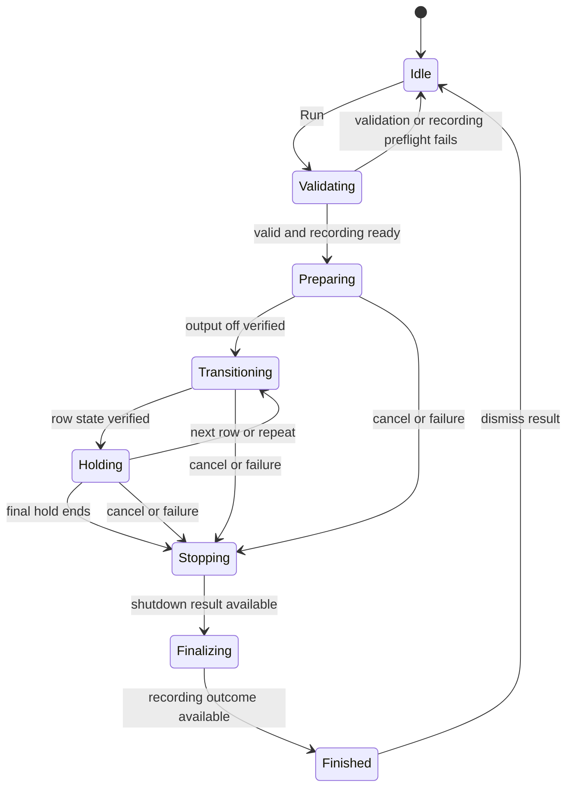

# Sequences, recording, and storage

## Sequence document

Store sequences as versioned JSON with explicit units in field names. The table edits a document; starting a run captures an immutable copy so later UI or file changes cannot alter an executing test.

```json
{
  "schemaVersion": 1,
  "name": "Unloaded connection check",
  "targetModel": "66332A",
  "repeatCount": 2,
  "steps": [
    {
      "id": "step-1",
      "label": "Low voltage",
      "voltageV": 1.0,
      "currentLimitA": 0.01,
      "outputEnabled": true,
      "holdSeconds": 3.0
    },
    {
      "id": "step-2",
      "label": "Output off",
      "voltageV": 0.0,
      "currentLimitA": 0.01,
      "outputEnabled": false,
      "holdSeconds": 2.0
    }
  ]
}
```

This is an illustrative document, not permission to run it on an attached load. Example files must never execute or enable output when opened.

Validation rules:

- Require a recognized schema version, supported target model, at least one step, unique step IDs, and a positive finite integer repeat count.
- Require finite voltage/current values within the current device/app limits and a finite hold of at least one second. Negative measured current is valid; negative current-limit requests require explicit device support and are not inferred from that fact.
- Validate all rows against a fresh capability/protection snapshot before starting. Validate again when a file, device, or protection configuration changes.
- Reject contradictory or malformed required fields and unknown future schema versions with an explanation. Never coerce invalid values to zero or discard rows silently.
- Bound import size and row count. Proposed v1 limits: 5 MiB, 10,000 rows, and 100,000 repeats. Check duration arithmetic for overflow and iterate repeats lazily instead of expanding the table in memory.
- Show errors per cell/row plus a concise summary. A valid JSON structure alone is not sufficient to enable Run.

The file stores requested settings. It does not store a promise that the instrument will accept identical values or that the load will remain in CV mode.

## Execution state machine



Store the run result as independent fields: `executionOutcome` (Completed, Cancelled, Failed), `shutdownOutcome` (VerifiedOff, Unverified), and `recordingOutcome` (Complete, Incomplete, Failed). The UI may say **Completed** without qualification only if execution completed, output-off was verified, and recording finalized. Otherwise show the specific problem, even if every row had finished.

### Preparation

1. Acquire the session's run-control lease and freeze the input document. Reject a second run or conflicting manual writes.
2. Refresh identity/session validity, capabilities, settings, and protections; validate every row and repeat count.
3. Create the recording files, write metadata and CSV headers, flush, and confirm writer health before any run-driven output enable. If manual recording is active, require it to be stopped and finalized before starting a run; do not implicitly truncate it.
4. Verify output-off using an internal preparation operation. Unlike the external Output Off action, this operation does not cancel the run it is preparing.
5. Apply the first row and verify it. Enable output only if that row explicitly requests it and the cancellation/generation checks still permit it.

### Row transitions

For a requested-off row, disable and verify output before applying its setpoints. For a requested-on row that begins with output off, apply and verify its setpoints before enabling. For on-to-on transitions, use the verified change-ordering policy in [plan 04](04-instrument-control.md). In every case, confirm setpoints, output state, and fault status before beginning the hold.

Re-check cancellation immediately before every write and after every await. The external Output Off path cancels the run permanently, invalidates pending steps, and has priority over all ordinary row work. No late completion may advance the sequence or restore output-on.

Repeat boundaries follow the same transition rules as any other adjacent rows. Do not add a hidden output interruption between repeats; the requested last/first row states determine the transition. The end of the final repeat always invokes shutdown.

### Hold timing and polling

Record a monotonic start time when the complete row state is acknowledged. Its deadline is `holdStart + requestedHold`. A delay before the hold does not consume hold time. Once that deadline is reached, dispatch the next transition when the instrument worker is available; record the actual duration and any lateness.

Use cancellable waits and compare against the clock on wakeup. Do not decrement a counter once per timer tick. Do not shorten the next hold to compensate for earlier latency, replay overdue transitions in a burst, or treat Windows scheduling as deterministic hardware timing.

Poll at the selected interval when it will not interfere with a due transition. At most one measurement cycle may be pending. Skipped opportunities are represented as gaps/events; a short row is not guaranteed to contain a measurement. The UI shows nominal hold duration separately from total elapsed time, which includes transitions.

Detect suspend/resume and excessive scheduling interruption; abort, attempt shutdown, and require an explicit new session. Never resume a test automatically after sleep or process restart.

### Finishing and cancellation

Normal completion, Stop, Output Off, protection trips, unexpected device settings, communication loss, and recording failure converge on shutdown. Preserve the original cause even if shutdown or file finalization also fails. Cancellation is not successful until its shutdown result is available; display Stopping while that work is pending.

There is no pause or resume in v1. After interruption, the operator starts a new run from the beginning. Returning to the manual workspace does not change the actual device settings; it shows the latest acknowledged state with output off, or explicitly unknown if verification failed.

## Recording format

Use a directory per recording, with a UTC-based name and collision-resistant ID. Automatic sequence recording begins during preparation; manual recording begins after a successful storage preflight. Only one recording session is active at a time.

```text
Documents/66332A Studio/Recordings/
  2026-11-03T223000Z_8e14c1a2/
    run.json
    sequence.json            present for sequence runs
    measurements.csv
    events.jsonl
```

While open, use `.partial` suffixes for active data files and `status: inProgress` in the manifest. Finalize data files first, then atomically replace the manifest last. If any step fails, retain recoverable files and mark/discover the directory as incomplete. On startup, list abandoned partial recordings; do not resume them or invent a successful end state.

### CSV schema, version 1

Use a fixed header, UTF-8, invariant decimal/scientific formatting, UTC ISO 8601 timestamps, explicit units, and proper CSV escaping. An empty optional field means unavailable; zero is a value. Each row represents one measurement attempt, including incomplete attempts when possible.

| Group | Columns |
| --- | --- |
| Identity/order | `schema_version`, `recording_id`, `sample_index`, `session_generation`, `source_kind` |
| Timing | `cycle_started_utc`, `cycle_completed_utc`, `elapsed_s`, `voltage_started_utc`, `voltage_completed_utc`, `current_started_utc`, `current_completed_utc` |
| Run position | `step_id`, `row_index`, `repeat_index`, `run_phase` |
| Requested state | `requested_voltage_v`, `requested_current_limit_a`, `requested_output_enabled` |
| Acknowledged state | `ack_voltage_v`, `ack_current_limit_a`, `ack_output_enabled`, `settings_verified_utc` |
| Measurements | `measured_voltage_v`, `measured_current_a`, `estimated_power_w`, `pair_skew_s`, `sample_quality` |
| Instrument status | `regulation_mode`, `operation_condition_raw`, `questionable_condition_raw`, `fault_flags`, `status_verified_utc` |

Use one-based row/repeat indexes for operator-facing records; document this in metadata. Manual recordings leave row/repeat fields empty. Requested settings are the active operation target, not unsent text in an editor. Acknowledged output can be `on`, `off`, or `unknown`; do not coerce unknown to false.

Do not attach a freshly read status timestamp to older measurements as if they were simultaneous. Record validity explicitly. `estimated_power_w` is absent when either member of the pair is missing, stale, or separated by a control transition. Export raw signed values with enough precision for later analysis; UI rounding does not alter recordings.

### Metadata and events

`run.json` includes schema/app version, source kind, instrument identity, connection profile, capabilities, start/end times, initial/final settings and protections, polling policy, units, clock semantics, sequence hash if applicable, the three result fields, and data filenames/counts. Sequence runs include the immutable executed sequence as a separate file.

`events.jsonl` records output requests/verification, control transitions, hold boundaries, row/repeat changes, faults, skipped polls, cancellation, disconnects, storage failures, and shutdown outcomes. Each event has an ID, monotonic elapsed time, UTC timestamp, type, relevant operation/row ID, and structured details. Keep operator notes and device error prose in JSON rather than mixing arbitrary text into numeric CSV columns.

Event and measurement order should be reconstructable even when wall-clock time changes. Wall-clock timestamps are for correlation; monotonic elapsed time is the authority for durations within one session.

## Storage health and durability

- Use a bounded asynchronous writer queue. Never silently drop recording data to keep charts smooth.
- Preflight directory access, file creation, header/metadata serialization, and flush. A successful preflight does not eliminate later disk-full or permission failures.
- Flush buffered data at least once per second and at row boundaries/terminal events. Document that abrupt power loss may still lose a tail of data; a successful API call is not a promise against all OS/device caching.
- Monitor writer errors and progress while writes or flushes are pending; an idle writer between slow polling cycles is not stalled. Proposed starting limits: 256 queued records and a 3-second stalled-writer threshold, adjustable from testing. A full queue, exceeded stall threshold, or write/flush error fails the recording and requests shutdown.
- The shutdown path must not wait for disk I/O to recover. Preserve its result in memory and, when possible, a separate bounded diagnostic log. If all writes fail, the UI remains the available report.
- Stopping a healthy manual recording finalizes files and leaves the output state unchanged. A recording failure follows the stricter output-off policy from the original brief.
- Plot buffers and recording buffers are independent. Bound live plot history to one hour plus a small fixed overhead for event markers; files stream for the full run duration.

## Preferences, presets, and recent recordings

Resolve Windows LocalApplicationData and Documents using known-folder APIs, not hardcoded user paths. Store preferences/presets under `%LOCALAPPDATA%/66332A Studio/`; default recordings to the Documents location above. Allow a writable recording destination when Documents is redirected or unavailable.

Preferences include window placement, selected serial profile, polling interval, plot range, reduced-motion preference, and recording destination. Clamp restored window bounds to a visible work area. Never persist an instruction to reconnect, rerun, or enable output at startup.

Presets contain named requested setpoints and protection values with a schema version and target model. Loading stages them for review. If a loaded preset changes protections, require the output-off protection workflow before application. Do not store an output-on action in a preset.

Write JSON through a same-directory temporary file and atomic replacement; retain a last-known-good backup for settings/presets. Handle malformed preferences by showing a clear recovery message and using defaults; do not erase the broken file silently. Discover recent recordings from manifests or a rebuildable small index, without introducing a database.
